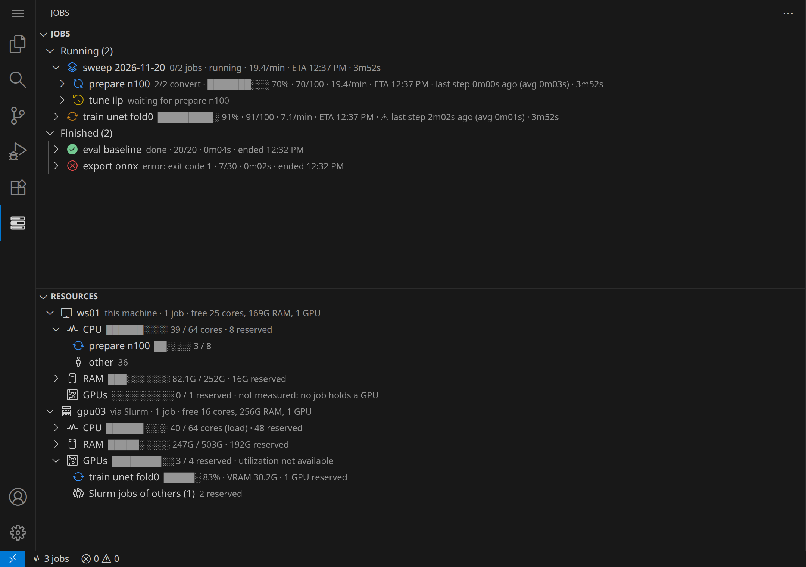

# jobboard

**Coding agents are great at running experiments on their own, but it is easy to lose track of what they
started. jobboard keeps you in control: a lightweight live board in VS Code shows every CPU and GPU job, from any
agent and on any node of your cluster, with progress, ETA and resource use.**

jobboard is a **VS Code extension** (the Job Board) with two companions: the **`jobrun` command-line tool**,
which starts and tracks the jobs, and a **skill for coding agents** (Claude Code, Codex, Cursor, Copilot, ...), so
the jobs they start show up on the board too. One installer sets up all three ([Install](#install)).

<p align="center">
  
</p>

- **No code changes.** Progress is read from the job's log: tqdm bars, `[12/100]` counters, or lines you count.
- **Anything that runs.** Local commands, processes that are already running, Slurm jobs.
- **Survives everything.** State lives in small files, not in the editor, so jobs stay tracked when VS Code
  closes, an SSH session drops or an agent's watcher dies.
- **Resources at a glance.** CPU, RAM, GPU and VRAM per node, and for each job what it uses next to what it
  reserved, so you see how much room is left for the next job.
- **Groups, pools, stages, dependencies.** Watch a whole sweep at once, let workers on several nodes share one
  list as a single job, see which stage of a pipeline a job is in, and chain jobs so one starts when the other has
  finished.
- **Tiny.** A single Python file that needs nothing beyond the standard library, plus a VS Code extension
  written in plain JavaScript.
- **Agent-friendly.** Comes with a skill, so Claude Code, Codex, Cursor or Copilot register every job they start.

## Install

jobboard has three parts: the **`jobrun` command**, the **VS Code extension** (the Job Board) and the **skill**
that teaches your coding agents to use `jobrun`. One command installs all three and asks about each:

```bash
curl -fsSL https://raw.githubusercontent.com/KreitnerL/jobboard/main/install.sh | sh
```

The setup wizard (`jobrun setup`) offers three steps, each of which you can skip:

1. **The `jobrun` command:** copied to `~/.local/share/jobboard/` and linked as `~/.local/bin/jobrun`. If that
   folder is not on your `PATH`, it offers to add it to your shell's rc file.
2. **The VS Code extension:** installed into `code`, `cursor`, `codium`, ... (whichever it finds). With
   Remote-SSH, run the installer on the remote host, where your jobs run.
3. **Your coding agents:** the jobrun [skill](skills/jobrun/SKILL.md), in the format of the
   [Agent Skills](https://agentskills.io) standard, copied to the global skill folder of each agent you pick.
   The wizard lists the agents it finds on the machine, none selected; `--agents ID,...` names them directly:

   | Agent | ID | Skill folder | Instruction file |
   |---|---|---|---|
   | Claude Code | `claude-code` | `~/.claude/skills` | `~/.claude/CLAUDE.md` |
   | Codex | `codex` | `~/.agents/skills` | `~/.codex/AGENTS.md` |
   | Cursor | `cursor` | `~/.cursor/skills` | |
   | GitHub Copilot | `github-copilot` | `~/.copilot/skills` | |
   | Gemini CLI | `gemini-cli` | `~/.gemini/skills` | `~/.gemini/GEMINI.md` |
   | OpenCode | `opencode` | `~/.config/opencode/skills` | |
   | Windsurf | `windsurf` | `~/.codeium/windsurf/skills` | |

   Optionally, it also adds one line to the agent's global instruction file, so the agent uses jobrun on its own
   initiative: *"Launch every command expected to run longer than ~2 minutes through `jobrun` (see the jobrun
   skill)."*

Setup never overwrites files it did not create: an existing skill, command or instruction that mentions jobrun is
left alone. Run it again at any time to update or to add what you skipped.

### Other ways to install, and what each one covers

| Route | `jobrun` command | Job Board | Agents |
|---|---|---|---|
| `curl … \| sh`, or `./install.sh` in a clone | ✓ | ✓ | ✓ (you pick) |
| `… \| sh -s -- --yes --agents claude-code,codex` | ✓ | ✓ | ✓ (no questions; without `--agents` no skill; also `--no-vscode`, `--no-instructions`) |
| `pipx install git+https://github.com/KreitnerL/jobboard` (or `uv tool install …`) | ✓ | run `jobrun setup` | run `jobrun setup` |
| VS Code extension only (`jobboard.vsix` from the [releases](https://github.com/KreitnerL/jobboard/releases)) | in VS Code terminals | ✓ | GitHub Copilot in VS Code; others: run the setup command it shows |
| Claude Code plugin: `/plugin install jobrun --marketplace KreitnerL/jobboard` | install separately | install separately | Claude Code (with updates) |
| [Agent Skills installer](https://skills.sh): `npx skills add KreitnerL/jobboard -g` | install separately | install separately | 70+ agents |
| Only the file: `curl -o ~/.local/bin/jobrun https://raw.githubusercontent.com/KreitnerL/jobboard/main/jobrun.py && chmod +x ~/.local/bin/jobrun` | ✓ | | |

The VS Code extension brings its own copy of `jobrun`: the Job Board works at once, `jobrun` works in VS Code's
terminals, and Copilot gets the skill. It cannot install the command for other shells or the skill for other
agents; on first start it shows the command that does (`jobrun setup`, run from the extension's copy), and its
**Set Up Terminal and Agents** button runs it.

Requires Linux and Python 3.9 or newer; nothing else.

## Try it

```bash
jobrun demo
```

starts three short example jobs (about 2 minutes) in one group: a training run with stages and a tqdm bar, a sweep
whose progress counts `Trial N completed` lines, and a report that waits for the training run. Watch them in the
**Jobs** view (activity bar) or with `jobrun ls`, then remove them with the trash icon or
`jobrun rm --group "jobrun demo"`. The empty Jobs view also has a **Run Demo Jobs** button.

## Uninstall

```bash
jobrun uninstall            # asks before removing; --yes for no questions
```

removes exactly what `jobrun setup` installed: the command, the PATH line, the extension, the skills and the
instruction lines (the rest of those files stays as it was). Files you changed since are kept unless you pass
`--force`. The job registry `~/.jobs` (your jobs and the logs jobrun wrote) is kept unless you agree or pass
`--purge`. Running jobs keep running and finish normally. If you installed with pipx or uv, also run
`pipx uninstall jobboard` (or `uv tool uninstall jobboard`). Installed another way: remove the extension in VS Code,
the Claude Code plugin with `/plugin uninstall jobrun`, and skills from `npx skills` with `npx skills remove jobrun -g`.

## Quick start

```bash
jobrun run --name "eval baseline" -- python eval.py --split test   # starts detached, prints id + log path
jobrun ls                                                          # or look at the sidebar
jobrun log "eval baseline" -f                                      # ids match by exact name or id substring
jobrun stop "eval baseline"
```

```
ID           STATUS   NAME            PROGRESS      RATE    ETA    LAST STEP            ELAPSED  WHERE
261102-a28f  running  eval baseline    41% 246/600  1.6/s   14:34  0m01s ago (avg 0m00s)  2m31s    ws01
```

## Progress

Detected automatically from the newest matching log line:

| Log line | Example |
|---|---|
| tqdm bar | `246/600 [02:31<03:40, 1.6it/s]` |
| bracketed counter | `[246/600] case_042 done` |
| explicit marker | `JOBRUN_PROGRESS 246/600` |

Otherwise, say what to look for:

```bash
--count-regex 'Trial \d+ completed' --total 100        # progress = number of matching lines
--progress-regex 'case (?P<done>\d+) of (?P<total>\d+)'
```

The rate covers the last 15 completed steps of the current stage, measured up to now (so a stall lowers it), and the
ETA is the remaining work divided by that rate. A window of recent steps follows runs whose steps get slower, e.g.
parallel workers that finish their short items first; on real tuning and rollout runs it predicted the finish more
accurately than the run average or a time window.

**Is it hanging?** Each running job also shows the time since its last step next to the average step time
(`last step 1h05m ago (avg 14m10s)`; `LAST STEP` in `jobrun ls`). Once that silence is longer than all of 4 average
steps, twice the longest gap between its recent steps, and 5 minutes, the job is flagged as stalled: `⚠` and an
orange icon in the sidebar, `!` in `jobrun ls`, `"stalled": true` in `ls --json`, and `jobrun wait --any` returns.
The average and the gaps cover the same last 15 steps as the rate, up to the last step. The gap term matters for
jobs whose steps arrive in bursts, such as parallel workers that finish together: their average step is much
shorter than the usual pause between bursts. Jobs that are waiting, have no timed step yet in the current stage, or
are past their total ("finishing") are never flagged. For loops with millions of steps, report by time, not per step,
so the log stays small:

```python
if time.monotonic() - last >= 10:
    print(f"JOBRUN_PROGRESS {done}/{total}", flush=True); last = time.monotonic()
```

## Groups

```bash
for v in small base large; do
  jobrun run --group "sweep 2026-11-02" --name "$v" --count-regex 'Trial \d+ completed' --total 100 \
    -- python tune.py --variant "$v"
done
jobrun stop --group "sweep 2026-11-02"
```

The sidebar shows one row per group: jobs finished, progress summed over all jobs, combined rate, and the ETA of
the slowest job. You get one notification when the group finishes, plus one for each job that fails.

## Pools

A pool is one job that several workers work through together: processes on this machine, Slurm jobs on other
nodes, started at once or added later. The list shows the pool as one row with the progress, rate and ETA of the
whole list; its workers are listed under it with their status and host, without progress bars of their own.

```bash
jobrun pool "eval queue 2026-11-24" --total 4500                          # optional: create it first
jobrun run    --pool "eval queue 2026-11-24" --name local --cpus 24 -- python worker.py queue.yml
jobrun sbatch --pool "eval queue 2026-11-24" --name node-b -- worker.sbatch queue.yml
jobrun edit ID --pool "eval queue 2026-11-24"                             # move a running job into the pool
```

`--pool NAME` joins the newest pool with that name (or id) and creates it if there is none; `jobrun pool NAME`
always creates a new one. A pool's group (`--group`) belongs to the pool, which counts as one job in it.

```
ID           STATUS   NAME                  PROGRESS          RATE      ETA        WHERE
261124-9a0c  running  eval queue            47% 2118/4500     3.19/min  Wed 00:04  2 workers on ws-1, node-b
261124-0f8c  running    └ local                                                       ws-1
261124-89f1  running    └ node-b                                                      node-b slurm:360348
```

**Progress of the list** is the newest reading any member reports: a progress bar, a counter or a
`JOBRUN_PROGRESS done/total` line about the whole list (not summed: every reading is about the same list). A
member that only reports, and works on no items, joins with `--role monitor`.

**Without a reading of the whole list**, workers can print `JOBRUN_ITEM [label]` after each finished item; the
pool's progress is then the sum of these items out of the pool's `--total`, and the label shows as the worker's last
item. `--item-regex` counts lines of programs that print no markers.

**Status:**

| Situation | Pool |
|---|---|
| a worker runs | running |
| a worker fails while others run | running, with a warning (the others take over its items) |
| all workers ended, list complete | done (with a warning if a worker failed) |
| all workers ended successfully, items left | done, with a warning: items may be unprocessed, or the count is stale |
| a worker failed and items are left, or every worker failed | error |
| no job joined yet | waiting; cancelled after 10 minutes; `stop` or `rm` ends it at once |

`--after POOL` waits for the whole pool, `stop POOL` stops all its workers, `stop WORKER` only that one. `wait`
treats a pool that ended with items left as unsuccessful (exit 1), and `wait --any POOL` wakes on a worker that
fails. In the sidebar, expand a pool to see its workers with their status, host and last item.

## Stages

A program announces its phases with one line each; progress, rate and ETA then apply per stage, and the
dashboard lists finished stages with their durations:

```bash
echo "JOBRUN_STAGE download 1/2"     # shell; in Python: print("JOBRUN_STAGE download 1/2", flush=True)
...
echo "JOBRUN_STAGE convert 2/2"
```

`--stages download,convert` lists planned stages before they are reached.

## Report problems

A job that keeps running although something went wrong (a failed sub-task, a skipped input, a fallback) can say so
with one line; jobrun cannot see such a failure otherwise:

```bash
echo "JOBRUN_EVENT error pipeline case15 failed: see logs/case15.log"   # Python: print("JOBRUN_EVENT error ...", flush=True)
echo "JOBRUN_EVENT warn disk almost full, skipping checkpoints"
```

The level is `error` or `warn` (also `warning`; an optional colon after it is fine), the rest of the line is the
message. The job is then marked as **degraded**: its message in the sidebar (red or yellow icon while it runs, with
the newest events in the tooltip), in `jobrun ls` (`[error: pipeline case15 failed ...]`) and in `ls --json` / `show`
(`degraded`: the most severe level so far, `events`: the newest five, `event_count`). The status itself stays as it
is, so the job still ends as done or error. Each new event is a notification (`notifyOn`: `event`) and wakes
`jobrun wait --any`.

## Dependencies

```bash
jobrun run --name "prepare n100" -- python prepare.py --n 100
jobrun run --name "tune base" --after "prepare n100" -- python tune.py base.yml
```

The second job is **waiting** (no elapsed time) until the first one succeeds, then starts; if the first one fails,
it is **cancelled**. The dashboard lists it right after the job it waits for, on the same level. `--after` takes ids or names, repeatable or
comma-separated. With `jobrun sbatch --after <slurm job>`, Slurm's own `--dependency=afterok` is used.

## Status

| Status | Icon | Meaning |
|---|---|---|
| waiting | 🕒 | not started: waits for `--after` jobs or in the Slurm queue |
| starting / running | ⟳ | |
| done | ✓ | exit code 0 |
| error | ✗ | non-zero exit, killed by a signal, time limit, out of memory (the reason is shown) |
| stopped | ■ | stopped by `jobrun stop` / `scancel` while running |
| cancelled | ⊘ | never started: a dependency failed, or stopped while waiting |
| lost | ⚠ | the supervisor vanished without recording an exit (e.g. reboot) |
| ended | ○ | a tracked process ended; its exit code is unknown |

## Changing a running job

```bash
jobrun edit ID --name "case15 pipeline" --group "sweep" --after "case15 tuning"     # also --after '' to clear
jobrun edit ID --stages tune,rollout --stage-at 'rollout=JOBRUN_PROGRESS' --count-regex 'Trial \d+ completed' --total 100
```

Only the registration changes; the command keeps running. `--stage-at NAME=REGEX` starts stage NAME at the first log
line matching REGEX, for programs that print no stage markers. A job that waits for its dependency by itself (e.g. a
script that polls) also shows as waiting once it has `--after`, and its runtime counts from the dependency's end.

## Slurm

```bash
jobrun sbatch --name "train fold0" -- --time=04:00:00 train.sbatch     # submit and track
jobrun track --slurm 324562                                            # track an existing job
jobrun sbatch --log 'logs/%x-%j.err' -- train.sbatch                   # read progress from stderr
```

States come from `sacct`, so this also works where `scontrol` is disabled. Results are cached for 30 s, so open
dashboards don't keep querying Slurm. Stop uses `scancel`.

## Wait for jobs

```bash
jobrun wait ID ID2        # or --group G: until all have ended; exits 0 only if everything finished successfully
jobrun wait --any ID ID2  # or --group G: until the first of them ends, reports a problem, or stalls
```

`--any` returns as soon as one of the jobs **ends** (also when one has ended already), reports a new
**`JOBRUN_EVENT`** ([Report problems](#report-problems)) or starts to **stall**. It prints one line per trigger, then
the jobs that are still active, and exits 0 only if every trigger is a job that finished successfully (`done`):

```
261123-c35f  error     tune base    33% 1/3 (exit code 3)  after 4m02s
261123-4c40  running   tune queue   JOBRUN_EVENT error: pipeline case15 failed
still active: 261123-6443 261123-4c40
```

For a pool, `--any` also returns when any single worker or monitor of the pool ends: a successful end prints its
own line (`261124-ef4d  done  slurm eris  worker of pool tune queue (261124-5ad8)  after 2h41m`), a failed one is
the pool's event (`worker slurm eris on eris ended (error: exit code 1)`). The still-active line gives the pool's
running workers, e.g. `still active: 261124-5ad8 (1 workers)`.

Events, stalls and pool members that end count from the moment `wait --any` starts, so waiting again on the same jobs
does not return for the same event. Jobs that have ended do. When jobs are still active, the last line is the command
to wait again:

```
rearm: jobrun wait --any 261124-5ad8 --since 1795600686.518
```

`--since T` counts events, pool members that ended and removals from time T (the check that found the triggers)
instead of from the start of the new wait, so nothing that happens while you act on the first triggers is lost. An
end in the few seconds that check took may be reported a second time.

A job removed while someone waits for it is reported with the status it had when it was removed
(`removed from the registry`), also a removed pool worker. A job that runs `--after` a removed job starts if that job
had ended `done`.

Without `--any`, `wait` waits for all jobs, as before; that stays the default because scripts rely on
`jobrun wait --group G && next-step`, which must not continue after the first job. Agents that watch several jobs
should use `--any` (or one `wait` per job), so that a crash is reported at once instead of when the last job ends.
Waiting is separate from running: if the waiting shell dies, the job keeps running and stays tracked.

## Resources

The **Resources** panel below the job list (and `jobrun res`) shows this machine and every node that runs an active
job. Each resource (CPU, RAM, each GPU) is a row with what is used, the total, and what is reserved; expand it to
see each job's share as **used / reserved**. The node row shows what is still **free** for new jobs: the total minus
the larger of what is used and what is reserved.

```
▾ workstation  this machine · 4 jobs · free 40 cores, 0 RAM, 0 GPU
  ▾ CPU     ████░░░░░░ 24 / 64 cores · 2 reserved
      tuning s4103         7.8 · no budget
      train unet           ██░░░░ 0.7 / 2
      other                0.4
  ▾ RAM     ███░░░░░░░ 83.7G / 252G · 296G reserved
      tuning s4103         █░░░░░ 21.2G / 96G
      train unet           ░░░░░░ 672M / 8G
      other                21.3G
  ▾ GPU 0   ███████░░░ 69% · VRAM 2.97G / 48G
      train unet           ████░░ 69% · VRAM 2.38G · 1 GPU reserved
      other                605M
```

**What a job has reserved**, per resource, from the first of:

1. its **Slurm allocation** (`squeue`), for Slurm jobs;
2. a declared **budget** (bookkeeping only, not enforced), preferably from the program itself, which knows its
   worker count: a log line `JOBRUN_BUDGET cpus=12 mem=96G gpus=1` (any subset of the keys; the newest line replaces
   the previous one, so a program can declare a budget per stage). Or given from outside:
   `jobrun run --cpus 8 --mem 20G --gpus 1 -- …`, `jobrun edit ID --cpus 12`; these take precedence per key;
3. the limits of the job's own **cgroup**, e.g. `systemd-run --user --scope -p MemoryMax=96G …` or `CPUQuota=`.
   Only the job's own scope counts, never a user-wide slice.

A node's reserved total is Slurm's allocations (all users) plus the budgets of your jobs that Slurm does not manage.

**How it is measured** (`jobboard.resourceSeconds`, default 15 s, only while the panel is visible):

- CPU and GPU utilization are **means since the last refresh**, from cumulative counters: `/proc` CPU ticks (exited
  workers included) and the driver's utilization samples since a timestamp (NVML). RAM and VRAM are current values;
  a job's RAM is the resident memory of its processes, so pages shared between forked workers count once per process.
- Nothing samples in the background. A refresh costs about 0.1 s of CPU: one pass over `/proc`, two short Slurm
  calls, and NVML only **while one of your jobs has the GPU open**. Querying an idle GPU would wake its driver (~2 s),
  so without a GPU job the GPU row shows only reservations.
- **Other nodes** are seen through Slurm only: reservations of all users, slurmd's load average and free memory (which
  lag by minutes and can read near zero on a busy node), and the usage of your own Slurm jobs (`sstat`). Such a node
  shows what is **reserved** first, and its bar fills with the larger of reserved and used: a reserved core is not
  free for a new job whatever the load says. Used is at least the sum of your jobs on the node, marked
  "(your jobs)" when that is higher than slurmd's figure. Their GPU utilization is not available.

## Logs

- `jobrun run` writes the command's output to `~/.jobs/logs/<id>.log`, or to `--log FILE`.
- `jobrun sbatch` writes the Slurm log there too, unless you or the script set `--output`.
- Removing a job (`rm`, `clean`, or the trash icon) also deletes the logs jobrun **wrote**. Logs it only
  **read**, such as your experiment's own log files, are never deleted.
- Every removal is recorded in `~/.jobs/removed.log`, one JSON line per job: its status and end time (so `wait` and
  `--after` still know how it ended), the jobrun command and the process that called it (a shell, an agent, or the
  VS Code extension), so a job missing from the list can be traced. Removing a finished worker of a pool that still
  runs also drops its items and its success from the pool's row.
- Logs jobrun writes are capped at 512 MB (setting `max_log_mb`, or `--max-log-mb` per job). Beyond that, jobrun cuts
  the **middle** of the log: it keeps the first 16 MB (`log_keep_head_mb`: configuration, early warnings) and the
  newest 256 MB, with a line saying what was dropped in between. The job is not affected: it keeps writing to the
  same file, and progress counting sees every line before it is cut. The Job Board shows how much was cut.
- Logs of Slurm jobs and adopted processes are written by the job itself, so jobrun cannot cap them; the Job Board
  marks them when they grow past `max_log_mb`.

## Settings

The **VS Code settings** (search for "Job Board") cover the dashboard:

| Setting | Default | |
|---|---|---|
| `finishedDays` | 30 | Show finished jobs of the last N days (nothing is deleted) |
| `notifyOn` | done, error, stalled, event | Notifications for: `done`, `error`, `stopped`, `cancelled`, `stalled`, `event` (a `JOBRUN_EVENT` line), `logTrimmed` |
| `etaFormat` | clock | `clock` (ETA 16:40), `remaining` (ETA in 2h10m) or `both` |
| `rowDetails` | all | Which of `rate`, `eta`, `lastStep`, `elapsed` a running job's row shows |
| `progressRow` | on | An expanded running job, pool or group shows its progress on its own row under the name; collapsed rows keep one line |
| `groupBy` | status | `status` (Running / Finished), `host` (one section per machine or Slurm node) or `none` |
| `statusBar` | running | Count `running` or `active` (also waiting) jobs, or `hidden` |
| `diskWarnGB` | 5 | Warn when the disk with the registry or a running job's log has less free space |
| `refreshSeconds` · `resourceSeconds` | 10 · 15 | How often the job list and the Resources view refresh |
| `updateWhileUnfocused` | off | Keep redrawing while VS Code is not focused (e.g. on a second monitor) |
| `command` · `registry` | | Path to `jobrun`; registry folder (`JOBRUN_HOME`) |

Settings that jobrun itself uses live in the registry's `config.json`, so they hold on every machine that shares
the registry, also for jobs started outside VS Code. The VS Code settings `stallFactor`, `stallGapFactor`,
`stallMinSeconds`, `maxLogMB`, `logKeepHeadMB` and `autoCleanDays` write it; `jobrun config` shows and changes it from the terminal:

```bash
jobrun config                        # all settings, with their source (default, config, env)
jobrun config auto_clean_days=90     # set; `--unset KEY` goes back to the default
```

| Key | Default | |
|---|---|---|
| `stall_factor` · `stall_gap_factor` · `stall_min_s` | 4 · 2 · 300 | A running job is **stalled** (⚠) after this many average step times without progress, this many times the longest recent gap between steps (0: ignore gaps), and at least this many seconds |
| `max_log_mb` · `log_keep_head_mb` | 512 · 16 | Log cap, and the start of the log that is always kept (see [Logs](#logs)) |
| `auto_clean_days` | 0 (never) | **Delete** finished jobs that ended more than N days ago, with the logs jobrun wrote; checked at most once an hour |

An environment variable `JOBRUN_<KEY>` (e.g. `JOBRUN_AUTO_CLEAN_DAYS=0`) takes precedence over the file.

## Use with AI coding agents

`jobrun setup` installs the [jobrun skill](skills/jobrun/SKILL.md) for the agents you pick (see
[Install](#install); also available as a Claude Code plugin and through `npx skills add`). The agent then launches every long command through `jobrun`, names and groups its jobs, picks
a sensible progress unit, declares the job's CPU budget, checks `jobrun res` before big jobs, and looks at
`jobrun ls` instead of asking you. For another agent, use `npx skills add KreitnerL/jobboard -g -a <agent>` or copy
`skills/jobrun` into its skills folder, and add the instruction line above to its instructions file.

## Commands

| Command | |
|---|---|
| `run [--fg] -- CMD` | Run under supervision: detached by default; `--fg` stays in the foreground and also prints the output |
| `pool NAME` | Create a [pool](#pools); workers join it with `--pool` on `run`, `sbatch`, `track` or `edit` |
| `sbatch -- ARGS` | Submit with `sbatch` and track |
| `track --pid PID` / `--slurm ID` | Adopt a running process or Slurm job; a process's log is detected from its stdout |
| `ls [--all] [--json]` | List jobs (finished ones from the last 3 days unless `--all`) |
| `res [--json]` | CPU, RAM, GPU, VRAM per node: used and reserved, per job |
| `show ID` · `log ID [-f]` | Details as JSON · tail the log |
| `wait [--any] ID` / `--group G` | Block until all have ended; `--any`: until one ends, reports a `JOBRUN_EVENT` or stalls |
| `stop ID` / `--group G` | SIGTERM to the whole process tree, then SIGKILL after 10 s; `scancel` for Slurm |
| `edit ID [options]` | Change name, group, `--after`, stages or progress settings, also while running |
| `rm ID` · `clean [--days 7]` | Remove from the list (with the logs jobrun wrote) |
| `config [KEY[=VALUE]]` | Show or change the [settings](#settings) |
| `demo` | Start three short example jobs |
| `setup` · `uninstall` | Install or remove the command, the VS Code extension and the agent skill |

Common options: `--name`, `--group`, `--pool`, `--role`, `--after`, `--stages`, `--stage-at`, `--log`, `--count-regex`,
`--progress-regex`, `--item-regex`, `--total`, and the budget `--cpus`, `--mem`, `--gpus`.

## Log markers

Lines a program can print (anywhere in a line; one per line) to tell jobrun what it is doing:

| Marker | |
|---|---|
| `JOBRUN_PROGRESS 246/600` | progress of the current stage ([Progress](#progress)) |
| `JOBRUN_STAGE convert 2/3` | a new stage begins; `2/3` is optional ([Stages](#stages)) |
| `JOBRUN_BUDGET cpus=12 mem=96G gpus=1` | what the job has been given, any subset of the keys ([Resources](#resources)) |
| `JOBRUN_EVENT error <message>` · `JOBRUN_EVENT warn <message>` | a problem while the job keeps running ([Report problems](#report-problems)) |
| `JOBRUN_ITEM [label]` | a pool's worker finished one item of the shared list ([Pools](#pools)) |

## How it works

Each job is a few small files in `~/.jobs` (`$JOBRUN_HOME`). Point it at a shared filesystem and jobs on cluster
nodes show up too.

- A small **supervisor** process starts the command, writes its output to the log, writes a heartbeat file every
  30 s and records the exit code. It uses about 13 MB of memory and practically no CPU.
- The supervisor also reads the log's new lines every 2 s for stages and progress, so stage times are right even
  when no dashboard is open. For tracked and Slurm jobs, the readers do this.
- **Readers** (`jobrun ls`, the sidebar every 10 s) work out status and progress: from the pid or heartbeat, from
  `sacct`, and from the log. Finished jobs are cached. One refresh with 300 finished jobs takes about 0.25 s.
- A job whose supervisor disappears without recording an exit (e.g. after a reboot) shows as **lost** instead of
  running forever.

Requires Linux (`/proc`) and Python ≥ 3.9. Slurm is optional.

`jobrun setup` records everything it creates in `~/.local/share/jobboard/install.json`; `jobrun uninstall` works
through that list.

## Development

```bash
./install.sh --link       # the jobrun command points at this clone, so edits take effect at once
python -m pytest -q tests
cd vscode && npx @vscode/vsce package -o jobboard.vsix && code --install-extension jobboard.vsix
```

Packaging the extension bundles `jobrun.py` and the skill into it (`vscode/scripts/bundle.js`).

## License

MIT
